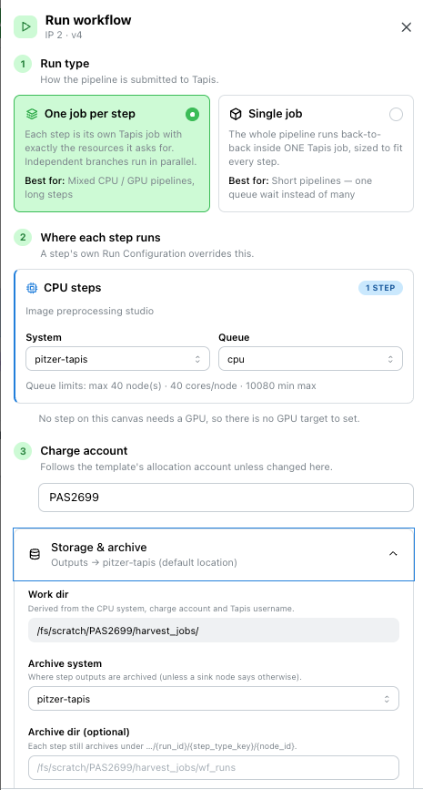
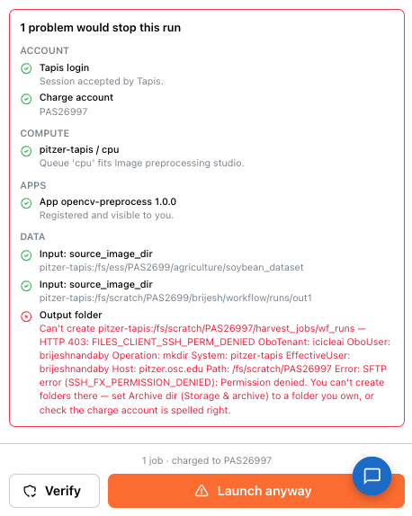
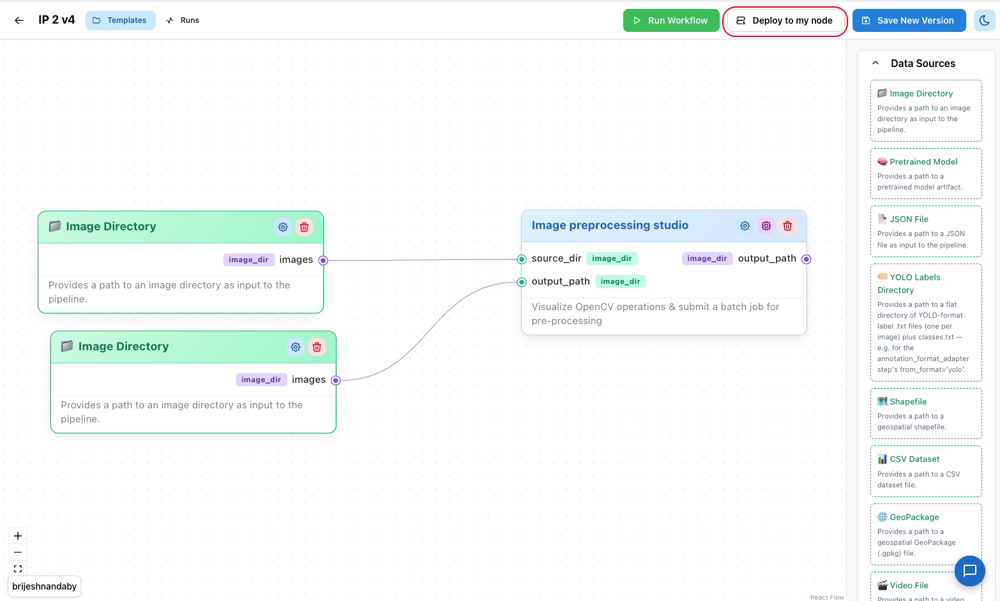
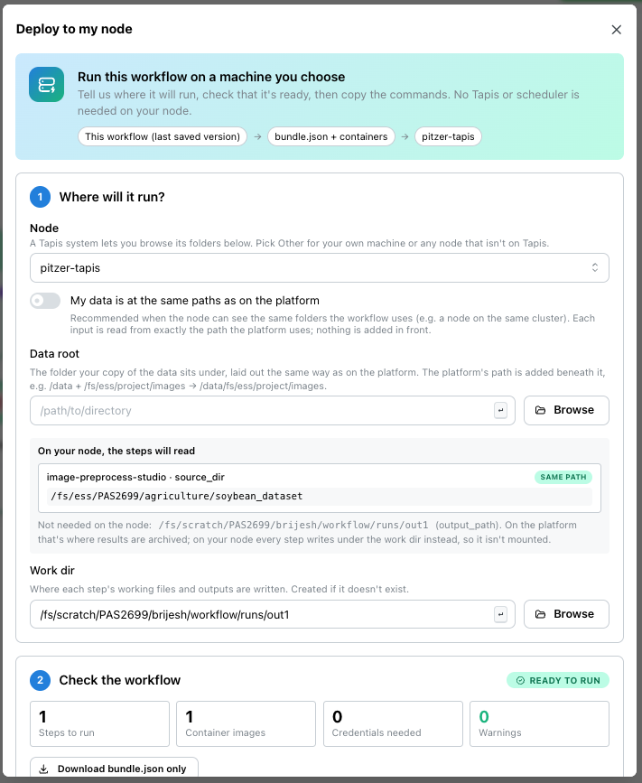
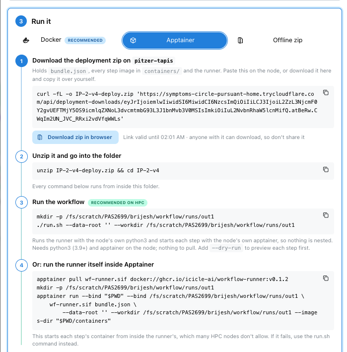
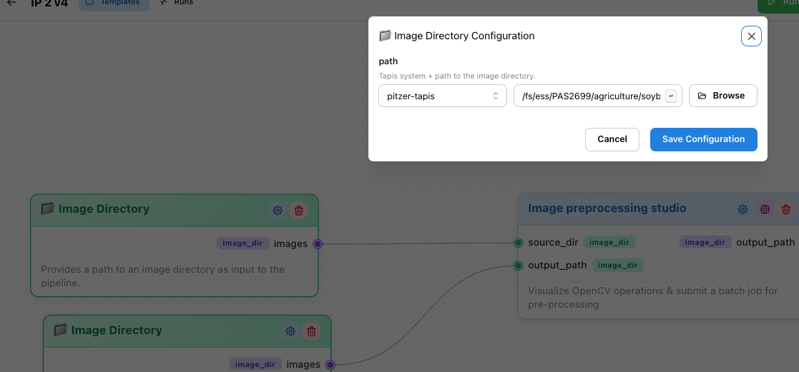
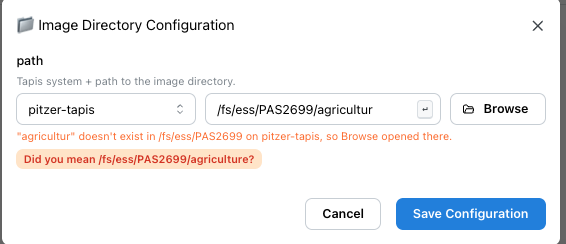
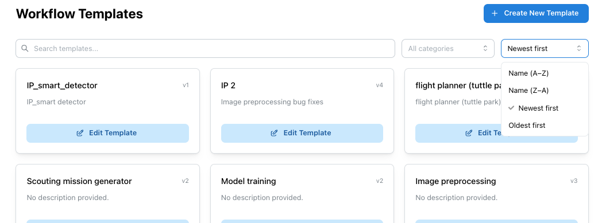
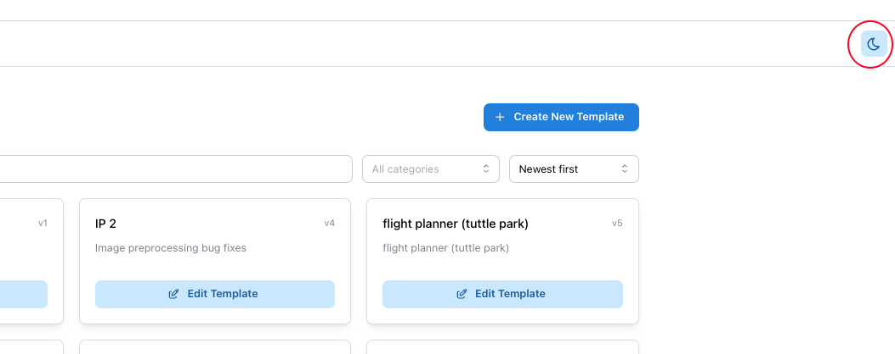
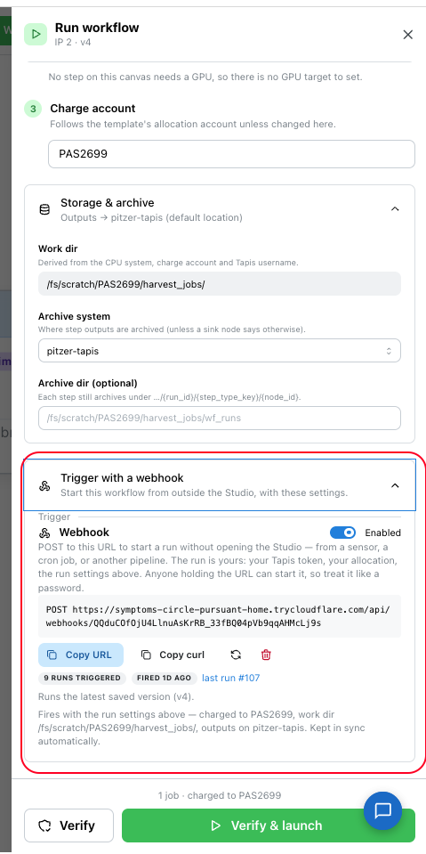

# No-Code Workflow Studio

A browser-based workflow builder for the full ML lifecycle: wire up a pipeline in
a drag-and-drop canvas — data sources, pre-processing, annotation, training,
inference, visualization, sinks — then execute it as a graph of real Tapis jobs
on HPC, and watch every step's status, config and logs live on the same canvas.

**Tags:** CI4AI, Digital-Agriculture, Software

### License

[](https://opensource.org/licenses/BSD-3-Clause)
<!-- Add any other licenses you want to include. -->

## References

- [Tapis Jobs API](https://tapis-project.github.io/live-docs/?service=Jobs) — the HPC job submission service each step is submitted to.
- [README.md](README.md) — install and run the frontend + backend locally.
- [backend/INTEGRATION.md](backend/INTEGRATION.md) — Tapis credentials, app/system provisioning, and what the engine needs before a job can run.
- [docs/adding-a-step-form.md](docs/adding-a-step-form.md) — add a new step whose settings UI is auto-generated from its schema.
- [docs/adding-a-step-custom-ui.md](docs/adding-a-step-custom-ui.md) — add a step with a custom interactive panel (map, labeler, live preview).
- [frontend/app/pages/README.md](frontend/app/pages/README.md) — the step settings page contract (`StepPanelProps`).
- [docs/local-deployment.md](docs/local-deployment.md) — technical details of running a workflow on your own machine.
- [CHANGELOG.md](CHANGELOG.md) — what's new.

## Acknowledgements

<!-- Please include other funding sources above this line. -->

*National Science Foundation (NSF) funded AI institute for Intelligent Cyberinfrastructure with Computational Learning in the Environment (ICICLE) (OAC 2112606)*

## Issue reporting

Please report issues via [GitHub Issues](https://github.com/ICICLE-ai/workflow-orchestrator/issues).

---

# Tutorials

## Build a workflow (canvas)

Open the app (locally, `http://localhost:5173` — see [README.md](README.md)).
The dashboard is the entry point: **Manage Templates** and **Past Runs**, with a
persistent *Templates* / *Runs* nav in the header and a ⚙ **Secrets** menu on
the right.


Sign in first — the widget in the bottom-left corner shows your Tapis username,
or a **Login with Tapis** button if you aren't signed in yet. Nothing that
touches files or submits jobs works until you are (see
[Sign in to Tapis](#sign-in-to-tapis)).

1. **Create a template** — go to **Templates → Create New Template**. You land on
   an empty canvas with the step palette down the right-hand side.

   

2. **Add steps** — the palette groups every registered step into collapsible
   sections: **Data Sources** (green, dashed), the eight pipeline stages —
   *Data Collection, Data Creation, Data Pre-processing, Data Harmonization,
   Training, Inference, Visualization, Post-processing* (blue), and **Data
   Sinks** (amber, dashed). Drag a card onto the canvas to add it as a node.

   

3. **Understand a node** — each node shows its display name, its **inputs** on
   the left (teal handles) and **outputs** on the right (violet handles), with a
   badge naming each port's data type. The header carries three actions:

   | Icon | Action |
   | --- | --- |
   | ⚙ (blue) | **Settings** — the step's own configuration (see step 5). |
   | 🖥 (purple) | **Run Configuration** — the compute this step requests. Hidden for design-time-only steps. |
   | 🗑 (red) | **Delete** the node and every edge attached to it. |

   

4. **Connect steps** — drag from an output handle to an input handle. Connections
   are **type-checked**: a link is only allowed when the source port's data type
   matches the target's, is a subtype of it, or the target declares a coercion
   from it. An incompatible drop is refused with a red *Invalid Connection*
   toast naming both ports and their types.

   

6. **Configure each step** — click ⚙ on a node. Most steps get a form generated
   straight from their schema (numbers, switches, dropdowns, text, a Tapis path
   picker, a secret selector). Steps with a richer UI — Smart Labeler, Zero-Shot
   Annotation, the Geospatial Map viewer, Flight Plan, Training, Visualization,
   PATRA publishing, the image pre-processing studio — open their own interactive
   panel instead, some of them full-screen. Press **Save Configuration** (or
   **Save & Close**) to write the values back onto the node.

   

7. **Set the compute (optional)** — click 🖥 on any step that submits a job to set
   node count, cores per node, memory, max runtime and GPUs. Leave *Execution
   system* empty to inherit the run's target; the badge in the corner tells you
   whether the step declares itself a **GPU step** or a **CPU step**. If you do
   pin a system, the queue dropdown loads that system's real queues and warns
   when a request exceeds the queue's limits.

   

8. **Save the template** — click **Save Template**, give it a name, description
   and allocation account, then **Confirm Save**.

   - Saving is **blocked** while any required input port has no incoming edge;
     the drawer lists exactly which node is missing which input.
   - Saving **warns** (but lets you proceed with *Save Anyway*) when a node's
     output isn't wired to a sink — those results won't be written anywhere.

   


Reopening a template from **Templates → Edit Template** puts you back on the
canvas with its title showing `name vN`. Saving again creates a **new version**
rather than overwriting the old one, so earlier runs keep pointing at exactly the
graph they executed.

## Run the workflow on Tapis

### Sign in

Standalone, click **Login with Tapis** in the bottom-left widget: the backend
redirects you to your Tapis tenant, and back to the app with a session cookie.
Embedded inside TapisUI, the host already holds your token — you're signed in
automatically and the widget shows your username with no login/logout controls.

### Configure the run

With a saved template open, click **Run Workflow** (green, top right). The **Run
workflow** drawer opens, with three numbered sections.




1. **Run type:** how the pipeline is sent to Tapis.
   - **One job per step** (default): each step gets exactly the resources it asks
     for. Best for mixed CPU/GPU pipelines and long steps.
   - **Single job**: the whole pipeline runs as one Tapis job, so there's one queue
     wait instead of many. Best for short pipelines. See [Run a whole pipeline as
     one Tapis job](#run-a-whole-pipeline-as-one-tapis-job).
2. **Where each step runs:** pick a system and queue for **CPU steps**, and for
   **GPU steps** if the canvas has any. Each card lists the steps it applies to,
   so Zero-Shot Annotation and Training can run on a GPU queue while Flight Plan
   and Geospatial run on a CPU queue **in the same run**. (In single-job mode this
   becomes **Where the job runs**.) A step's own Run Configuration overrides this.
3. **Charge account:** the allocation to charge, e.g. `PAS2699`. It's filled in
   from the template's allocation account.

Two optional sections sit below, closed by default:

- **Storage & archive:** where outputs are written (work dir, archive system,
  archive dir). The defaults are usually right.
- **Trigger with a webhook:** a URL that starts this workflow from outside the
  Studio. See [Trigger a workflow from outside
  (webhook)](#trigger-a-workflow-from-outside-webhook).

Field-by-field detail is in [Run settings reference](#run-settings-reference).

### Verify before launching

At the bottom of the drawer there are two buttons:

- **Verify** checks the run on Tapis without launching anything.
- **Verify & launch** runs the same checks, then launches only if nothing would
  stop the run.



The checks, grouped as they appear:

| Group | What's checked |
| --- | --- |
| **Account** | Your Tapis login is accepted. |
| **Plan** | The workflow has steps that submit jobs; in single-job mode, that it can run as one job. |
| **Compute** | Each system is reachable, each queue exists, and every step's request (nodes, cores, memory, time) fits the queue's limits. |
| **Apps** | Each step's Tapis app is registered and visible to you. |
| **Data** | Each input path exists, and the output folder can be created. |

Each check shows ✓ passed, ⚠ warning or ✗ problem, with a short reason. Then:

- **All passed** or **only warnings:** the run launches (or is ready to).
- **A problem:** the run is not launched. Fix it, or press **Launch anyway** if
  you know better.
- **Changed a setting after verifying?** The result is marked *settings changed —
  re-verify*, and **Verify & launch** checks again before launching.

These are the mistakes that used to fail a run minutes in: an output folder you
can't write to, an app that isn't registered, a queue that doesn't exist, a
request over a queue's limits, or a missing input. Verifying catches them before
the run is created.

Good to know:

- Verifying creates the base output folder if it doesn't exist (the first thing
  any run would do there). It's the only reliable way to test that you can write
  to it.
- With **unsaved changes**, the checks use the last saved version, and you're
  asked to save before the run starts. Either way **what runs is what's on
  screen**: you can keep the edits as a new version, or run them without
  recording one.

### Watch it run

Launching takes you straight to `/runs/{id}`: the same graph, read-only, with
each node tinted by its live status.


| Node state | Meaning |
| --- | --- |
| **Pending** (grey, faded) | Not started. Shows *Waiting on: …* while an upstream step is unfinished. |
| **Running** (blue) | The step's Tapis job is in flight. |
| **Completed** (green) | Finished; its outgoing edges start animating. |
| **Failed** (red) | The step errored — open its logs. |
| **Blocked** / **Cancelled** | Upstream failure, or the run was stopped. |

A second, smaller badge carries the raw **Tapis job status** — the full
vocabulary (`STAGING_INPUTS`, `QUEUED`, `RUNNING`, `ARCHIVING`, `FINISHED`, …) —
so a step that looks stuck can be told apart from one merely sitting in a queue.
The page polls every 2.5 s while the run is `RUNNING`; ⟳ in the header refreshes
on demand.

**Click any node** to open its logs: the step's resolved configuration, Tapis'
own outcome message, the orchestrator's error (if any), and the tail of the
container's `tapisjob.out`. Nodes that never submit a job (Smart Labeler, the
map viewer, …) open their own panel read-only against the run's resolved values
instead, so you can inspect what they produced.


The ⚙ in the header shows the run's frozen launch configuration; **Edit Template**
jumps back to the canvas. A run that isn't in flight gets a **Resume** button —
carry on from where it stopped, or redo a chosen step and everything after it —
and a `FAILED` or `CANCELLED` one also gets **Start over**, which relaunches it
from the beginning as a new run with the same settings. See
[Stop, resume, and recover](#stop-resume-and-recover).

**Past Runs** (`/runs`) lists every run with its status, with a search box and
filters for status and ordering. Expand a finished run for its per-step
breakdown and logs, hit **View Live Graph** on an active one, **Stop** it — which
cancels the workflow and any in-flight Tapis job — or **Resume** a stopped or
failed one straight from the list.


## Run the workflow on your own machine

Instead of submitting jobs to Tapis, you can run a saved workflow on a machine you
choose: an HPC node, a lab GPU box, or your own computer. You download one zip,
copy a few commands, and the workflow runs there. Nothing on that machine talks
back to the platform while it runs.

Open a saved template and click **Deploy to my node** (top right of the canvas).



The dialog has three steps.



### 1. Where will it run?

1. **Node:** pick the Tapis system your machine belongs to (e.g. `pitzer-tapis`).
   If it isn't on Tapis, pick **Other (my own machine)** and give it a name, like
   `lab-gpu-01`.
2. **My data is at the same paths as on the platform:** leave this **on** when
   your machine can see the same folders the workflow uses, for example a node on
   the same cluster. Turn it off only if you've copied the data somewhere else;
   then choose that folder as the **Data root**.
3. **Work dir:** the folder where results are written. It's created if it doesn't
   exist.

Use **Browse** to pick folders (Tapis systems only). Below the fields, a preview
shows exactly where each input will be read from. Check it before going on.


Your choices are saved for this workflow (you'll see *Saved for this workflow ✓*),
so they're filled in next time, on any browser, and for new versions.

### 2. Check the workflow

A summary shows the number of steps, container images, credentials needed and
any warnings, with a **Ready to run** or **Needs attention** badge. Read any
warnings before continuing. Steps that only run inside the platform are listed
here, since they can't run on your machine.

### 3. Run it

Pick a tab and follow its numbered steps. Every command has a copy button.

| Tab | Use it when |
| --- | --- |
| **Apptainer** | Your machine has Apptainer, which most HPC clusters do. Recommended on HPC. |
| **Docker** | Your machine has Docker and allows privileged containers. |
| **Offline zip** | Your machine has no network access. Download the zip here and copy it over. |

On the machine, the steps are the same for both Docker and Apptainer:

```bash
# 1. Download the zip (copy the exact command from the dialog)
curl -fL -o my-workflow-v3-deploy.zip '<link from the dialog>'

# 2. Unzip it and go into the folder
unzip my-workflow-v3-deploy.zip && cd my-workflow-v3

# 3. Run it. Apptainer route shown; the Docker tab gives its own command
./run.sh --data-root / --workdir /path/to/workdir --dry-run   # check first
./run.sh --data-root / --workdir /path/to/workdir             # then run
```



Tips:

- **Download links work for one hour.** If one has expired, copy a fresh one from
  the dialog.
- **Start with `--dry-run`.** It checks that every input is found and prints what
  each step would run, without running anything.
- **Changed a path after unzipping?** No need to download everything again. Use
  the dialog's *Changed the paths after unzipping?* box to replace just
  `bundle.json`, then run again.
- **Credentials:** if the workflow needs any (e.g. `HF_TOKEN`), the dialog shows
  an `export` step. They are never stored in the download.
- **Results** go into the work dir: one folder per step, plus a
  `run-<id>-report.json` summary.

---

# How-To Guides

## Sign in to Tapis

| Situation | What happens |
| --- | --- |
| Standalone app | **Login with Tapis** → OAuth2 redirect → session cookie. **Logout** clears it. |
| Embedded in TapisUI | The host's Tapis token is picked up automatically; no login/logout is offered. |
| Local dev, no Tapis client | Set `TAPIS_USE_MOCK=true` in `backend/.env` and `/login` gives you a mock session so the app stays runnable. |

Your token is what the engine submits jobs *as*, so runs are owned by, and
charged to, the person who launched them.

## Point a step at files on Tapis

Any path field rendered by the generic form (schema type `tapis_path`) gives you
a **system** dropdown plus a path box with a **Browse** button that opens the
Tapis file explorer scoped to the selected system. Pick a file or a directory
depending on what the field wants; the chosen system is stored alongside the
path, and downstream steps receive the full `tapis://system/path` URI rather than
a bare path.

Available systems: `pitzer-tapis`, `cardinal-tapis`, `ascend-tapis`,
`expanse-tapis`, `expanse-tapis-static`.



**Shortcuts**

| Where | Press | Does |
| --- | --- | --- |
| In a path box | **Enter** | Opens Browse at the typed path. |
| In the file browser | **Enter** | Selects the folder you're in (or the highlighted file, for a file field). |

If you Tab to a folder in the browser and press **Enter**, it opens that folder
instead, so keyboard navigation still works.

**Typos and missing folders.** If the typed path doesn't exist, Browse opens the
nearest folder that does and tells you so. When a folder name is close to one
that exists, it offers a fix, such as *Did you mean /fs/ess/PAS2699/agriculture?*
A path ending in `/` always opens that folder, even in a file field.



**Data that's only on your own machine.** Choose **My node (not on Tapis)** in the
system dropdown and type the path as it is on your machine. Browse is off for
these. A workflow using one can only run with
[Deploy to my node](#run-the-workflow-on-your-own-machine); launching it on Tapis
explains this instead of starting a run that can't reach your data.

## Find a template or run

Both lists have a search box, a filter and a sort order:

| List | Search by | Filter by | Sort by |
| --- | --- | --- | --- |
| **Templates** | name or description | category | name (A–Z, Z–A), newest or oldest |
| **Past Runs** | workflow name or run number | status | newest or oldest, name (A–Z, Z–A) |



## Switch between light and dark mode

Click the sun/moon icon in the header. Your choice applies everywhere in the
Studio, including the canvas and dialogs.



## Store an API token as a secret

Some steps need a credential (Weights & Biases, Hugging Face, …). Never type it
into a config field — put it in the vault instead:

1. Click the ⚙ **Secrets** icon on the dashboard header.
2. Enter a **key** (e.g. `WANDB_API_KEY`), the **value**, and an optional
   description, then **Add secret**.


Secrets are shared across your team and **write-only** — the list never returns a
value again. A step field of type `secret` then offers a dropdown of keys, and
only the *key* is stored on the node, in the saved template, and in the run's
frozen config. The real value is resolved server-side and substituted into the
job spec at submission time only.

Steps that always need one specific secret can reference it directly in their job
template as `${secrets.KEY}`, with no per-node field at all — see
[docs/adding-a-step-form.md](docs/adding-a-step-form.md).

## Send GPU and CPU steps to different systems

1. In the **Run workflow** drawer, set the **CPU steps** system and queue — every step
   with no GPU requirement follows it.
2. Set the **GPU steps** system and queue — every step whose definition declares
   `"resources": {"gpu": true}` follows this one instead. The card lists which
   steps on your canvas that currently applies to.
3. To take one specific node off both, open its 🖥 **Run Configuration** and pick
   an **Execution system** there. That pins the step to its own system and queue,
   ignoring the run's targets. Clearing it returns the step to inheriting.

Archiving stays run-level regardless: a run whose GPU steps are on Expanse and
CPU steps on OSC still writes all its artifacts to one place.

## Run settings reference

| Section | Field | Meaning |
| --- | --- | --- |
| 1. Run type | **One job per step / Single job** | One Tapis job per step (default), or the whole pipeline as one job sized from the pipeline-wide maximum. See [Run a whole pipeline as one Tapis job](#run-a-whole-pipeline-as-one-tapis-job). |
| 2. Where each step runs | **CPU steps: System, Queue** | Where steps with no GPU requirement run. Queues are loaded live from the system, with each queue's limits shown. The system also becomes the default archive system. |
| | **GPU steps: System, Queue** | Where steps declaring a GPU requirement run. Only shown when the canvas has one. |
| 3. Charge account | **Charge account** | The allocation to charge (e.g. `PAS2699`). Prefilled from the template's allocation account. |
| Storage & archive | **Work dir** | Derived from the CPU system, charge account and your Tapis username. Read-only. |
| | **Archive system** | Where step outputs are archived, unless a sink node says otherwise. |
| | **Archive dir (optional)** | Base directory on the archive system. Blank derives it from *Work dir*. |

Whatever you choose, each step archives under
`.../{run_id}/{step_type_key}/{node_id}`, so one run's artifacts never collide
with another's.

## Run a whole pipeline as one Tapis job

By default each step is its own Tapis job. That gets every step exactly the
resources it asks for and lets independent branches run at the same time — but it
also means a five-step workflow queues five times, and on a busy allocation the
queue wait is usually longer than the compute.

**Run workflow → Run type → Single job** submits the entire pipeline as ONE Tapis
job instead. The steps run one after another inside a single allocation, so there
is one queue wait for the whole workflow.

### How the one job is sized

One job makes one resource request, so the per-step requests are merged into an
envelope that fits every step. The panel shows the arithmetic, and hovering a row
lists what each step asked for:

| Field | Merged by | Why |
| --- | --- | --- |
| Nodes, Cores / node, Memory | **max** across steps | The job has to be able to host the hungriest step. |
| GPUs | **max** across steps | As above — and only when a step actually wants one. |
| Max runtime | **sum** across steps | They run one after another in this one allocation. A wall clock of only the longest step would have the scheduler kill the job partway through the pipeline. |

Each number is taken from what the step would really have used on its own: the
node's own **Run Configuration** if it has one, otherwise the step's own job
definition. Sources, sinks and panel steps request no compute and are ignored.

### GPUs

GPU resources are requested **only when some step actually needs one**. A pipeline
whose steps are all CPU-only goes to the run's CPU target with no `-G` request at
all, so it is never queued behind GPU availability it has no use for. As soon as
one step declares a GPU requirement, the whole job goes to the run's **GPU** target
and asks for the largest GPU count any step wanted. The panel's badge says which
target was chosen, and names the steps responsible.

### What you give up

- **Concurrency.** Independent branches that would have overlapped now run in
  sequence. That is why runtime is summed.
- **Per-step checkpoints.** *Resume* on a single-job run re-runs the whole
  pipeline: the allocation it ran in is gone, so there is no mid-job state to pick
  up from. Resuming from a specific step is refused rather than silently ignored.
  Per-step mode still gives you checkpoints (see [Stop, resume, and recover](#stop-resume-and-recover)).
- **Per-step exec systems.** One job has one exec system, so a node pinned to its
  own is ignored — with a warning naming it.
- **Steps that run inside the platform.** A step like *Annotation Format Adapter*
  executes Python in the backend, not in a container, so there is nothing for the
  one job to run. Those pipelines are refused up front, naming the step, and
  **Verify & launch** is disabled rather than offering a run that would fail.

Everything else is unchanged: the same run page, the same per-step statuses and
artifact paths, the same archive layout. The job's own report is read back out of
the archive when it finishes, so a single job still fills in each step's outputs
individually instead of showing one opaque bar.

### Operator setup (required once)

This mode submits one job of a **`wf-runner`** Tapis app — the same runner that
powers *Deploy to my node*, registered as a ZIP-runtime app so it can invoke
`apptainer` per step on the compute node. Until that app exists in your tenant,
the panel will still show the merged job it *would* submit, but nothing can be
launched.

[`runner/tapis-app/README.md`](runner/tapis-app/README.md) has the app definition
and the registration steps. Two backend settings matter:

| Variable | Meaning |
| --- | --- |
| `WF_RUNNER_APP_ID` / `WF_RUNNER_APP_VERSION` | The registered app (defaults `wf-runner` / `1.0`). |
| `WF_RUNNER_IMAGES_DIR` | Directory on the exec system holding the step `.sif` images. Strongly recommended: without it, images with a known URL are staged into the job on every run, and a pipeline using an image with no known source is refused. |

## Trigger a workflow from outside (webhook)

A webhook is a secret URL that starts your workflow from outside the Studio: a
field sensor, a cron job on your own machine, or another pipeline can launch it
with no browser and no login.

1. Open a saved template and click **Run Workflow**.
2. Set up the run as usual (run type, where steps run, charge account).
3. Open **Trigger with a webhook** at the bottom of the drawer. The webhook is
   created the first time you open it.
4. Use **Copy URL** or **Copy curl**. Calling it starts a run:

```bash
curl -X POST "https://<backend>/api/webhooks/<token>"
```



The panel also shows how many runs the webhook has started, when it last fired,
a link to its last run, and which version a call would run.

What a call runs, and as whom:

- **Your run.** It fires as *you* — your Tapis token, your allocation, your entry
  in *Past Runs* — whoever calls the URL.
- **The latest saved version.** A webhook belongs to the workflow, not to the
  version you happened to create it on, so saving a new version changes what the
  URL runs. The panel names the version a call would execute. Drafts (from *run
  without saving*) are skipped.
- **The run settings in the drawer.** The webhook uses the run type, systems,
  queues, charge account and archive paths shown in the drawer. Change any of
  them and the webhook is updated automatically. If saving fails, the panel says
  so in red, shows the settings the webhook still uses, and offers to retry.
- **Nothing from the request.** Any JSON body you POST is read and discarded: an
  unauthenticated caller must not be able to redirect a charge account or an
  archive path.

The URL is the only credential involved, so treat it like a password:

| Control | Effect |
| --- | --- |
| **Enabled** switch | Turns the URL off and on. Copies already handed out work again once re-enabled. |
| **Regenerate** (↻) | Issues a new URL and kills the old one — what to press if a URL leaks. |
| **Delete** (🗑) | Removes the webhook. Runs it already started are untouched. |

Unknown, deleted and disabled tokens all answer `404 No such webhook`, with
nothing to tell them apart, so the endpoint can't be used to hunt for live URLs.
Two fires of the same webhook less than `WEBHOOK_MIN_INTERVAL_SECONDS` apart
(default 5) are refused with `429`, so a retry loop on the caller's end can't
spend an allocation queueing one run per request.

Backend configuration: set `WEBHOOK_BASE_URL` when the backend is reachable from
outside on a different host than `APP_BASE_URL` (a tunnel, a reverse proxy) — the
URL handed to the user is built from it.

A *trigger* is the entity behind all of this, and webhook is its first kind. The
API is shaped for the ones that follow (a schedule, a file arriving, an upstream
run finishing): they are new `trigger_type` values on
`POST /api/workflow-templates/{template_version_id}/triggers`, not new endpoints.
See `WorkflowTrigger` in `backend/models.py` for the model and its security
notes, and the `triggers` tag in [docs/openapi.yaml](docs/openapi.yaml) for the
full surface.

## Run configuration reference (per step)

| Field | Default | Meaning |
| --- | --- | --- |
| **Execution system** | `expanse-tapis-static` | Pin this step to its own system. Clear it to follow the run's CPU or GPU target. |
| **Queue** | `tapisShared` (GPU steps: `tapisGPUShared`) | Only selectable once a system is pinned. |
| **Node count** | 1 | Nodes requested. |
| **Cores per node** | 8 | Cores per node requested. |
| **Memory (MB)** | 800 | Memory requested. |
| **Max runtime (minutes)** | 30 | Wall-clock limit. |
| **GPUs** | 0 (GPU steps: 1) | Becomes a `-G <n>` scheduler request. `0` on a GPU step removes it. |

These override whatever the step type's own job template specifies. When a queue
is pinned, over-requesting against its published limits is flagged here rather
than by a Tapis rejection minutes into the run.

## Fix a workflow that won't save

| Message | Fix |
| --- | --- |
| *"X" is missing required input "y"* | Connect that input to an upstream output or a data source. Optional inputs are never flagged. |
| *"X" output "y" is not saved to a sink* | Add a sink node (e.g. **💾 Write Results (JSON)**) and wire the output into it — or press **Save Anyway** if leaving it unconsumed is deliberate. |
| *Cannot connect: … is incompatible with …* | The two ports' data types don't match. Insert an adapter step, or use a port of the right type. |

## Stop, resume, and recover

- **Stop** a running run from the *Past Runs* list. This cancels the durable
  workflow, its child step workflows, and any in-flight Tapis job. Stopping is
  not the end of the run — a stopped run can be resumed.
- **Resume** picks the run back up without repeating work it already did. Steps
  that completed keep their outputs; only what never finished runs again. It's
  on the run's page, and on any `FAILED` or `CANCELLED` run in the *Past Runs*
  list for the one-click case.
- **Start over** appears on a `FAILED` or `CANCELLED` run's page and launches the
  same template version with the same Tapis options as a *separate* run, leaving
  this one's record intact — no re-entering settings.

### Resuming from a checkpoint

The run page's **Resume** button opens a picker with two kinds of choice:

- *Continue where it stopped* — every completed step is kept, and the steps that
  failed, were cancelled, or never started run again.
- *Redo `<step>` and everything after it* — re-runs that step even if it already
  succeeded, along with everything downstream of it, because redoing a step
  invalidates the inputs its dependents consumed. Steps upstream are untouched.

Either way the modal lists exactly which steps will re-run and which are
preserved before you commit.

When you name a step, you can also edit **that step's configuration** right in
the modal. The change applies to this resume only — the saved template is not
touched — which is the quick path for a run that broke on a bad parameter: fix
the value, resume from that step, and the hours of completed work before it are
not repeated. To change the workflow itself instead, use **Edit Template** on the
run page; it opens the exact version that ran, and saving creates a new version
to launch fresh.

Resuming continues the *same* run rather than creating a new one, so a run's
history stays one thread no matter how many attempts it took.

## Add or update a container image link (developers)

When a workflow runs on someone's own machine, each step's container image
(`.sif`) is downloaded from a link. All of these links are kept in one file:
**`backend/image_sources.json`**.

1. Create a download link for the image, e.g. a Tapis postit. Give it plenty of
   allowed uses and a long expiry, because every download uses one.
2. Add it to the `images` section. The key is the step's Tapis app id (or its
   step name); case and `-`/`_` don't matter:
   ```json
   "generate-flight-plan": "https://icicleai.tapis.io/v3/files/postits/redeem/…"
   ```
3. Check it:
   ```bash
   cd backend && uv run python scripts/check_image_sources.py
   ```
   It lists every step and its link, and flags keys that don't match a step.

No restart is needed. From then on, any workflow using that step includes the
image in its deployment zip and shows the link in the Deploy dialog and the zip's
README.

For training, inference and preprocessing, a link here replaces the one in the
step's own `step.json` when deploying. Platform runs still use `step.json`, so
update both when the link changes.

## Add a new step type

Steps are registered from `backend/steps/<key>/step.json` — no frontend code is
needed for a step whose settings are ordinary fields.

- Form-rendered settings: [docs/adding-a-step-form.md](docs/adding-a-step-form.md)
- Custom interactive panel: [docs/adding-a-step-custom-ui.md](docs/adding-a-step-custom-ui.md)

---

# Explanation

## Templates, versions, and runs

A **template** is a named graph: nodes (a step type + its configuration) and
edges (output port → input port). Saving an existing template writes a **new
version** instead of mutating it, and a run always points at one specific
version. Launching with unsaved edits still records the exact graph behind the
scenes — as a version if you asked for one, otherwise as a hidden draft — so
every run stays reproducible and none of them silently changes meaning when you
edit the template later.

A **run** additionally freezes its launch configuration (exec systems, queues,
account, directories, and the resolved node/edge snapshot). That frozen config is
what the engine reads when rendering each step's job, and what the run page's ⚙
drawer shows you afterwards.

## Ports and type compatibility

Every port has a data type — `image_dir`, `pytorch_model`, `json_results`,
`csv_data`, `shapefile`, `geopackage`, `heatmap_image`, and others. An edge is
allowed when:

1. the types are identical, or
2. the source type is a **subtype** of the target type (e.g. `image_dir` into a
   port accepting `file_collection`), or
3. the target type declares a **coercion** from the source type.

This is checked in the browser as you draw the connection, and again on the
server when the template is saved. It is what makes a graph structurally valid
before a single job is submitted.

## The step catalogue

| Stage | Steps |
| --- | --- |
| **Data Sources** | Image Directory, YOLO Labels Directory, CSV Dataset, JSON File, Pretrained Model, Shapefile, GeoPackage |
| **Data Collection** | Extract Frames |
| **Data Pre-processing** | Preprocessing, Image Crop, Image pre-processing studio |
| **Training** | Model Training, Publish to PATRA |
| **Inference** | Model Inference, YOLO Inference, Object Detection, Image Classifier, Zero-Shot Annotation, Few-Shot Annotation, Smart Labeler |
| **Visualization** | Visualization, Heatmap Generation, Class Histogram, Geospatial Map Viewer |
| **Post-processing** | Geospatial (GeoPackage), Custom Shapefile, Flight Plan Generator, Mission Export Adapter, Annotation Format Adapter |
| **Data Sinks** | Write Image Directory, Write Model, Write Results (JSON), Write CSV, Write Shapefile, Write Heatmap |

Sources have outputs but no inputs; sinks have inputs but no outputs. Empty
stages still appear in the palette so the pipeline's shape stays visible.

## Design-time steps vs job steps

Most steps submit a Tapis job. A few — Smart Labeler, the Geospatial Map viewer,
the Annotation Format Adapter's editor — are **design-time only**: they run
entirely in the browser against Tapis files, produce their output there and then,
and never queue anything. Those nodes have no 🖥 Run Configuration icon (there's
no compute to request), and on a run page clicking one opens its panel rather
than a log view.

## From node to Tapis job

When a run executes, the engine walks the DAG in dependency order. For each node
it resolves the node's inputs from its incoming edges (binding the upstream
step's output URIs to this step's input ports), merges the node's frozen
configuration, resolves any secret references, renders the step type's Tapis job
template by substituting `${…}` placeholders, and submits it to
`POST /v3/jobs/submit`. It then polls the job's status until it finishes,
recording each transition against the step — which is exactly what the canvas is
showing you live. Per-step state lives in `pipeline_run` / `run_step`; if no
Tapis credential is configured the engine falls back to a mock client so the
system still runs end-to-end locally.

Full detail, including credentials and the provisioning a real run requires, is
in [backend/INTEGRATION.md](backend/INTEGRATION.md).
